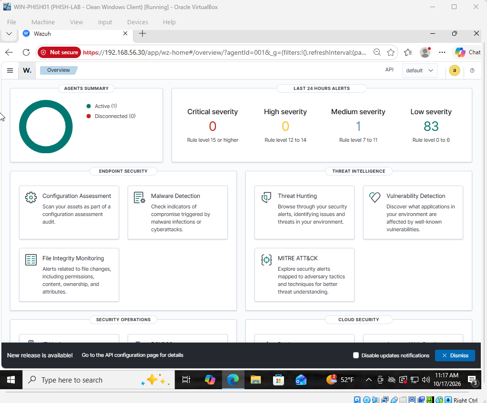
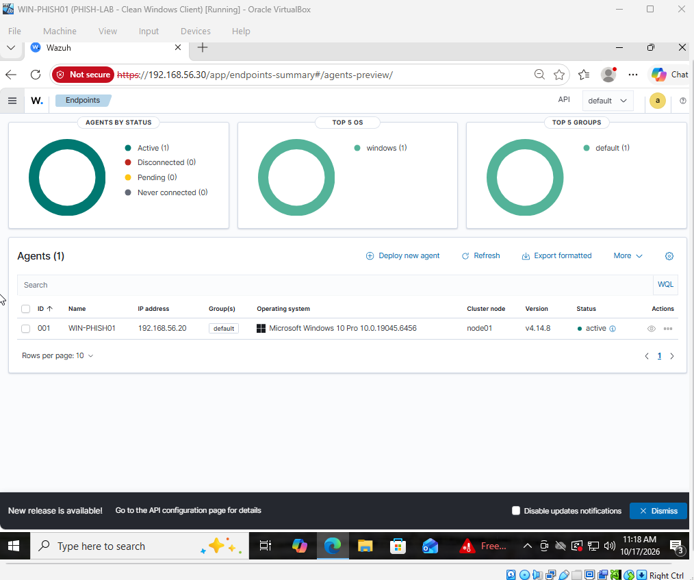
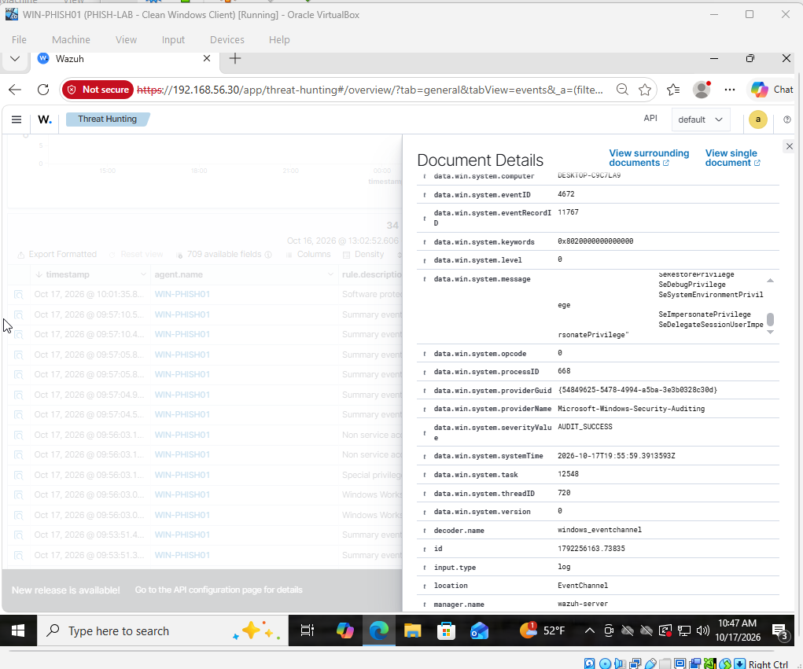
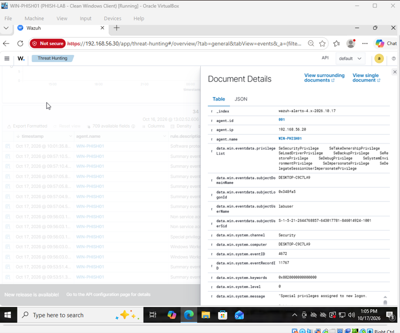
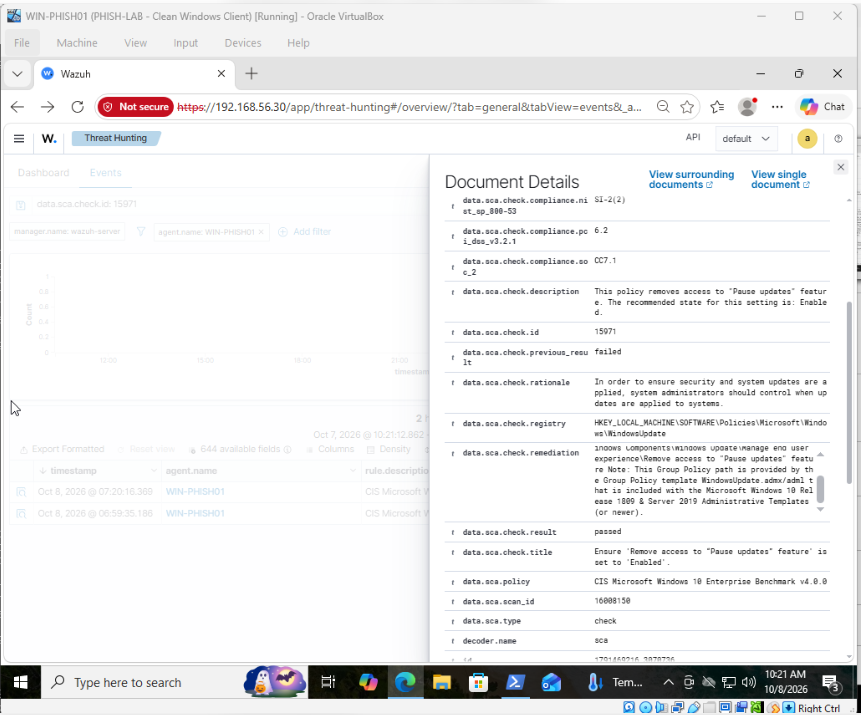
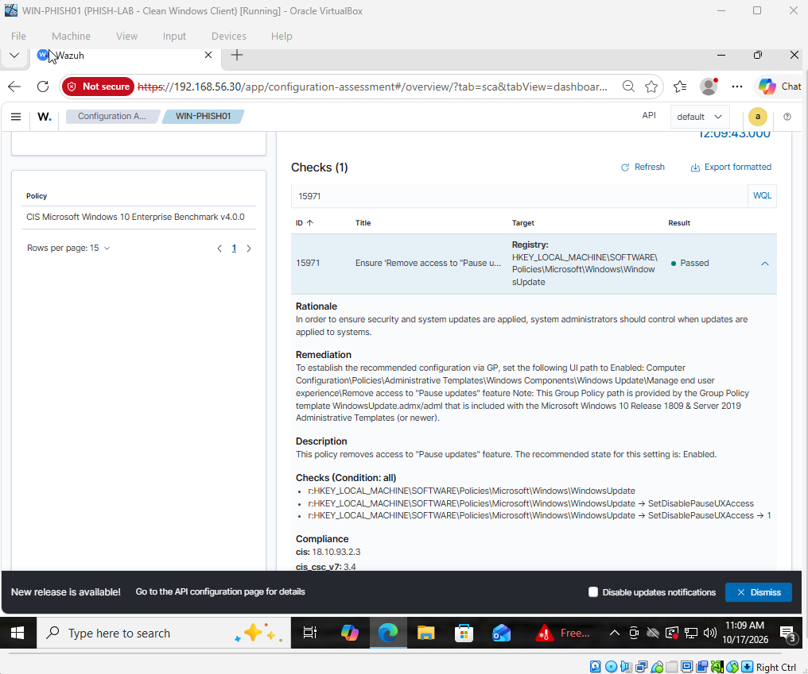

# Wazuh SIEM & Endpoint Security Monitoring Homelab

## Project Overview

This project simulates a small enterprise security monitoring environment using Oracle VirtualBox, Wazuh SIEM, Ubuntu Server, and Windows 10. The goal was to gain hands-on experience with centralized log collection, endpoint monitoring, security event investigation, and system hardening.

I configured a Wazuh server to monitor a Windows workstation, investigated security alerts using Wazuh's built-in detection rules, and used CIS security benchmarks to identify and remediate a Windows configuration issue.

## Technologies Used

Wazuh SIEM: Centralized security monitoring, event analysis, and configuration assessment

Ubuntu Server 24.04: Hosts the Wazuh Manager, Indexer, and Dashboard

Windows 10 Pro: Monitored endpoint running the Wazuh agent

Oracle VirtualBox: Virtual machine hosting and isolated network configuration

Kali Linux: Network traffic analysis and isolated security-awareness testing

Wireshark: Packet capture and HTTP traffic inspection

PowerShell: Windows configuration, service verification, and log testing

## Lab Architecture

The environment uses an isolated VirtualBox network named PHISH-LAB.

| Machine | Role | Lab IP Address |
|---|---|---|
| WAZUH-SERVER | SIEM server and monitoring platform | 192.168.56.30 |
| WIN-PHISH01 | Windows workstation monitored by Wazuh | 192.168.56.20 |
| Kali Linux | Network analysis and security-awareness testing | 192.168.56.10 |

The virtual machines communicate through the isolated lab network, while separate NAT adapters provide internet access where needed.

### 1. SIEM Deployment and Endpoint Monitoring

I installed and configured Wazuh on Ubuntu Server and deployed the Wazuh agent on a Windows 10 workstation.

After establishing network connectivity, I configured the agent to communicate with the Wazuh server through TCP port 1514.

I verified that the Windows agent was actively connected and that Windows security events were successfully reaching the SIEM.

#### Wazuh Dashboard

#### Connected Windows Endpoint

### 2. Security Event Investigation

I used Wazuh's built-in detection rules to investigate security events generated by the Windows workstation.

One investigation focused on:

Wazuh Rule: 67028

Windows Event ID: 4672

Detection: Special privileges assigned to new logon

Account: labuser

Endpoint: WIN-PHISH01

Wazuh recorded a privileged logon event containing security-related permissions, including SeSecurityPrivilege, SeBackupPrivilege, and SeRestorePrivilege.

I reviewed the event details, identified the associated Windows account, and compared the event with my own login activity.

Because the event corresponded to an authorized lab login, I assessed it as expected administrative activity rather than evidence of an attack.

This exercise helped me understand how SOC analysts investigate alerts and distinguish normal administrative activity from potentially suspicious behavior.

#### Security Event Details

### 3. CIS Benchmark Assessment and Remediation

I used Wazuh's Security Configuration Assessment feature to evaluate the Windows workstation against the CIS Microsoft Windows 10 Enterprise Benchmark v4.0.0.

During the assessment, I identified a failed security configuration check:

CIS Check ID: 15971

Policy: Remove access to the "Pause updates" feature

Recommended setting: Enabled

This policy helps prevent users from delaying Windows updates through the Pause Updates feature.

I reviewed the recommended configuration, applied the appropriate Windows Group Policy setting, and verified the result using Wazuh.

The security assessment confirmed that the check changed from Failed to Passed.

#### Remediation Evidence

### 4. Network Traffic Analysis

I used Wireshark on Kali Linux to capture traffic between the Windows workstation and a locally hosted security-awareness training webpage.

I examined HTTP requests, responses, source and destination IP addresses, and protocol headers.

The exercise demonstrated how unencrypted HTTP traffic can expose information in transit and reinforced the importance of encrypted communication.

The simulation was conducted within the isolated lab environment and did not involve credential collection.

### 5. Challenges and Troubleshooting

During the project, I encountered several technical issues involving virtual machine performance, Windows-to-Ubuntu connectivity, and custom Wazuh detection rules.

I troubleshot these issues by inspecting service logs, verifying network connectivity, testing event collection, and validating Wazuh configuration files.

I also experimented with custom Wazuh detection rules. Although the rules passed configuration validation and Logtest, I could not verify that they generated live alerts. I removed the experimental rules and completed the security investigation using Wazuh's built-in detection capabilities.

This experience strengthened my ability to troubleshoot technical problems systematically and distinguish verified results from unresolved issues.

### 6. Project Results

Through this homelab, I successfully:

Deployed a Wazuh SIEM environment on Ubuntu Server.

Connected and monitored a Windows 10 endpoint.

Centralized Windows security event collection.

Investigated privileged account activity using Wazuh detection rules.

Identified and remediated a failed CIS benchmark check.

Verified the security configuration improvement.

Captured and analyzed network traffic using Wireshark.

Gained practical experience with SIEM administration, endpoint security, and security operations.

## Key Takeaways

This project helped me understand how security teams use centralized monitoring platforms to investigate system activity, identify security risks, and verify remediation.

It also gave me experience working with virtual infrastructure, Windows and Linux systems, Wazuh, and common SOC investigation workflows.
